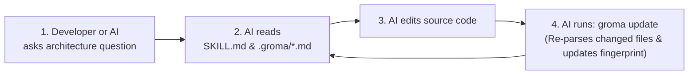

# Groma 

> **Deterministic Codebase Knowledge, Architecture Mapping & Skill Generator for IDE AI Agents**  
> *100% offline • Zero LLM API keys required • Sub-second incremental updates*


---

## 📖 Table of Contents

1. [What is Groma?](#-what-is-groma)
2. [What Can Groma Be Used For?](#-what-can-groma-be-used-for)
3. [Key Features](#-key-features)
4. [Installation & Quick Start](#-installation--quick-start)
5. [Command Reference](#-command-reference)
6. [What Groma Generates in Your Project](#-what-groma-generates-in-your-project)
7. [How the AI Agent Synchronization Loop Works](#-how-the-ai-agent-synchronization-loop-works)
8. [Development & Running Tests](#-development--running-tests)
9. [License](#-license)

---

## 💡 What is Groma?

When you use AI coding assistants (**Antigravity**, **Cursor**, **Claude Code**, **Windsurf**, or **GitHub Copilot**) on a growing project, two problems happen constantly:
1. **Token Waste & Slow Discovery**: At the start of every task, the AI wastes time and tokens running dozens of file searches (`grep`, `find`, `read_file`) just to figure out how your project is structured.
2. **Stale Documentation & Hallucinations**: Hand-written `ARCHITECTURE.md` files quickly fall out of sync with the actual code, causing the AI to hallucinate imports, call outdated function signatures, or break hidden dependents.

**Groma solves both problems deterministically.**

Groma is a static analysis CLI engine that scans your repository, parses source code ASTs into a unified schema, builds a directed dependency graph (using **NetworkX**), and generates structured knowledge docs (`.groma/*.md`), an AI skill entrypoint (`.agents/skills/<project>-knowledge/SKILL.md`), and zero-lag IDE synchronization rules (`.agents/rules/groma-sync.md` and `.cursorrules`).

---

## 🎯 What Can Groma Be Used For?

### 1. Instant Zero-Shot Context for IDE AI Agents
Drop Groma into any repository and run `groma scan`. Your IDE AI agent immediately receives a complete map of your classes, function signatures, line numbers, HTTP routes, and module dependencies—without having to search your codebase from scratch.

### 2. Refactoring Blast-Radius & Impact Analysis
Before modifying a core module (e.g., `auth.py` or `schema.py`), run `groma check`. Groma traverses the reverse dependency graph and lists **every file in the repository that directly or transitively depends on the modified file**, preventing unexpected breaking changes.

### 3. Self-Maintaining Architecture Documentation
New engineers and AI agents alike can read `.groma/architecture.md`, `.groma/file-map.md`, and `.groma/dependencies.md` to see:
- Which frameworks the project uses (`FastAPI`, `Django`, `Next.js`, `React`, `Laravel`, etc.).
- The **Core Hubs** of the codebase (ranked by Fan-In / In-Degree centrality).
- Every HTTP API endpoint (`GET`, `POST`, `PUT`, `DELETE`), its handler function, and exact file/line location.

### 4. CI/CD Documentation & Freshness Gate
Because `groma check` exits with code `0` when up-to-date and code `1` when stale, you can run `groma check` in GitHub Actions or pre-commit hooks to guarantee your codebase map is never out of sync with your code.

---

## ✨ Key Features

- **🔒 100% Local & Deterministic**: Runs entirely on your machine using Python's AST and NetworkX. No LLM API keys, no cloud calls, and zero cost.
- **🧹 Smart `.gitignore` & Dependency Filtering**: Automatically respects root and nested `.gitignore` files and ignores dependency manifests/lockfiles (`package.json`, `package-lock.json`, `requirements.txt`, `pyproject.toml`, `poetry.lock`, `uv.lock`, `go.mod`, `Cargo.toml`, `node_modules/`, `.venv/`, `vendor/`) so non-code edits never trigger false staleness alerts.
- **⚡ Sub-Second SHA-256 Fingerprinting**: Uses a fast `size` + `mtime` cache check before streaming 64 KB chunks through SHA-256. Unchanged files require zero disk reads.
- **🔄 Rename-Aware Diff Engine**: Automatically detects when a file is moved or renamed by matching SHA-256 content hashes across deleted and added paths.
- **🧠 Zero-Lag AI Rules**: Generates targeted rules so your AI responds immediately to casual questions (zero latency) and only runs `groma update` after modifying source code.

---

## 🚀 Installation & Quick Start

Groma supports **both** JavaScript/TypeScript workflows (`npx` / `npm`) and Python workflows (`pipx` / `pip`).

> **Prerequisite**: Python `3.10+` installed on your system.

### Option A: Using `npx` / `npm` (For JS / TS / Web Developers)

Run Groma directly from GitHub or npm with **zero manual setup**:

```bash
# Run directly with npx
npx git+https://github.com/Unknown-strange/Groma.git scan

# Or install globally via npm
npm install -g git+https://github.com/Unknown-strange/Groma.git
groma scan
```

### Option B: Using `pipx` (Recommended Global CLI for Python Users)

`pipx` installs Groma into an isolated environment and makes the `groma` command available globally in any terminal:

```bash
pipx install git+https://github.com/Unknown-strange/Groma.git
```

Now navigate to **any project** on your machine and run:

```bash
cd /path/to/your-project
groma scan
```

### Option C: Using `pip` (Inside a Virtual Environment)

```bash
pip install git+https://github.com/Unknown-strange/Groma.git
```

### Option D: Clone & Run Locally from Source

```bash
# 1. Clone the repository
git clone https://github.com/Unknown-strange/Groma.git
cd Groma

# 2. Create and activate a virtual environment
python3 -m venv .venv
source .venv/bin/activate

# 3. Install dependencies
pip install --upgrade pip
pip install typer rich pydantic pathspec networkx pytest ruff

# 4. Run Groma (via Python or Node wrapper)
python -m groma scan .
# or:
node bin/groma.js scan .
```

---

## 🛠️ Command Reference

Groma provides **3 core commands**:

### 1. `groma scan [PATH]` — Initial Baseline & Full Build
Walks the target repository (defaults to current directory `.`), computes SHA-256 hashes, parses all source files into the unified `FileAnalysis` schema, builds the NetworkX dependency graph, and writes all `.groma/` docs, `SKILL.md`, and IDE agent rules.

```bash
# Scan the current repository
groma scan

# Scan another project on your machine
groma scan /path/to/another-project
```

**Example Output:**
```text
             Groma Baseline Scan Summary              
┏━━━━━━━━━━━━━━━━━━━━━┳━━━━━━━━━━━━━━━━━━━━━━━━━━━━━━┓
┃ Property            ┃ Value                        ┃
┡━━━━━━━━━━━━━━━━━━━━━╇━━━━━━━━━━━━━━━━━━━━━━━━━━━━━━┩
│ Project Name        │ Groma                        │
│ Tracked Files       │ 21                           │
│ Frameworks          │ Pydantic, Pytest, Typer      │
│ Core Hubs           │ 11                           │
│ Summary Fingerprint │ 08f32b8190803047...          │
│ Generated Docs      │ 6 files (.groma/ & .agents/) │
└─────────────────────┴──────────────────────────────┘
╭──────────────────────────────────────────────────────────────────────────────╮
│ ✓ Baseline scan complete!                                                    │
│ Run groma check anytime to verify freshness, or groma update after making    │
│ code changes.                                                                │
╰──────────────────────────────────────────────────────────────────────────────╯
```

---

### 2. `groma check [PATH]` — Read-Only Staleness & Impact Detection
Compares the current files on disk against `.groma/manifest.json` **without modifying any files**.
- Reuses cached hashes when file `size` and `mtime` are unchanged (~0.1s execution).
- **Exit Code `0`**: Working tree matches the baseline fingerprint (`UP TO DATE`).
- **Exit Code `1`**: Working tree has changed (`STALE`). Lists `Modified`, `Added`, `Deleted`, and `Renamed` files alongside the **Impact Radius** (every file that directly or transitively depends on the changed files).

```bash
# Check the current repository
groma check

# Check another repository
groma check /path/to/another-project
```

**Example Output (When Clean):**
```text
╭──────────────────────────────────────────────────────────────────────────────╮
│ ✓ UP TO DATE                                                                 │
│ Project: Groma                                                               │
│ Fingerprint:                                                                 │
│ 08f32b819080304759a20dbf7306e20778c32334d0091761aba020ded3ed8e27             │
│ Files: 21 source files verified                                              │
╰──────────────────────────────────────────────────────────────────────────────╯
```

**Example Output (When Stale):**
```text
╭──────────────────────────────────────────────────────────────────────────────╮
│ ⚠️ STALE: Working tree has changed since last Groma sync!                    │
│ Baseline Fingerprint: 6abd4e8cbd9c5f29...                                    │
│ Current Fingerprint:  08f32b8190803047...                                    │
│                                                                              │
│ Modified (1):                                                                │
│   • groma/schema.py                                                          │
│                                                                              │
│ Impact Radius (10 dependent files affected):                                 │
│   ↳ groma/cli.py                                                             │
│   ↳ groma/graph.py                                                           │
│   ↳ groma/manifest.py                                                        │
│   ↳ groma/parsers/python_ast.py                                              │
│   ...                                                                        │
│                                                                              │
│ Please run groma update to re-synchronize.                                   │
╰──────────────────────────────────────────────────────────────────────────────╯
```

---

### 3. `groma update [PATH]` — Fast Incremental Rebuild
Instead of re-parsing the entire repository, `groma update` diffs the working tree against `.groma/manifest.json`, loads cached ASTs from `.groma/file-index.json`, and **re-parses only the Added/Modified files**. It then rebuilds the dependency graph, updates `.groma/*.md` and `SKILL.md`, and writes the new fingerprint.

```bash
# Incrementally update the current repository
groma update

# Incrementally update another repository
groma update /path/to/another-project
```

**Example Output:**
```text
╭──────────────────────────────────────────────────────────────────────────────╮
│ ✓ SYNCHRONIZED                                                               │
│ Project: Groma                                                               │
│ Re-parsed: 1 changed files                                                   │
│ Deleted: 0 files                                                             │
│ New Fingerprint:                                                             │
│ 08f32b819080304759a20dbf7306e20778c32334d0091761aba020ded3ed8e27             │
╰──────────────────────────────────────────────────────────────────────────────╯
```

---

### 4. `groma --version` / `groma --help`
```bash
groma --version   # Display installed Groma version
groma --help      # Show all available commands and options
```

---

## 📂 What Groma Generates in Your Project

When you run `groma scan` or `groma update`, Groma creates the following structure inside the target repository:

```text
your-project/
├── .groma/
│   ├── manifest.json       # Per-file {hash, size, mtime, language} + master SHA-256 fingerprint
│   ├── file-index.json     # Cached AST symbol models (FileAnalysis) for incremental updates
│   ├── architecture.md     # Project overview, detected frameworks, Core Hubs table, HTTP routes
│   ├── file-map.md         # Complete directory & symbol map (classes, methods, signatures, lines)
│   └── dependencies.md     # Per-file "Imports" (outgoing) and "Imported By" (incoming) tables
│
├── .agents/
│   ├── skills/
│   │   └── <project>-knowledge/
│   │       └── SKILL.md    # AI Agent skill entrypoint with YAML frontmatter & fingerprint
│   └── rules/
│       └── groma-sync.md   # Zero-lag synchronization rules for Antigravity & multi-agent IDEs
│
└── .cursorrules            # Automatic synchronization rules for Cursor IDE
```

> **Note**: Because `.groma/` and `.agents/` start with a dot (`.`), they may be hidden in your editor's sidebar by default. In VS Code or Cursor, press <kbd>Cmd</kbd> + <kbd>Shift</kbd> + <kbd>.</kbd> (Mac) or <kbd>Ctrl</kbd> + <kbd>Shift</kbd> + <kbd>.</kbd> (Windows/Linux) to toggle hidden files.

---

## 🔄 How the AI Agent Synchronization Loop Works

Why doesn't the AI corrupt your documentation over time?  
Because **the AI never hand-edits `.groma/*.md`**. Instead, Groma's generated rules instruct the AI to follow a deterministic loop:



1. **Casual Chat / General Questions**: The AI responds immediately without running any terminal commands (zero added latency).
2. **Codebase Architecture Questions**: The AI consults `.groma/architecture.md`, `.groma/file-map.md`, and `.groma/dependencies.md`, running `groma check` if it needs to verify freshness.
3. **After Editing Code**: Whenever the AI creates, modifies, or deletes source files, it runs `groma update` at the end of its turn so the skill and fingerprint stay 100% synchronized.

---

## 🧪 Development & Running Tests

To run Groma's test suite and linter locally:

```bash
# Activate virtual environment
source .venv/bin/activate

# Run all 24 unit and CLI integration tests
pytest -v

# Run Ruff linter
ruff check .
```

---

## 📄 License

MIT © Prince Edwin Nyarko
