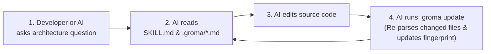

# Groma

> **Deterministic Codebase Knowledge, Architecture Mapping & Skill Generator for IDE AI Agents**  

---

## 📖 Table of Contents

1. [What is Groma?](#-what-is-groma)
2. [What Can Groma Be Used For?](#-what-can-groma-be-used-for)
3. [Key Features](#-key-features)
4. [Installation & Quick Start](#-installation--quick-start)
5. [How to Update / Upgrade](#-how-to-update--upgrade)
6. [Command & MCP Reference](#-command--mcp-reference)
7. [What Groma Generates in Your Project](#-what-groma-generates-in-your-project)
8. [How the AI Agent Synchronization Loop Works](#-how-the-ai-agent-synchronization-loop-works)
9. [Development & Running Tests](#-development--running-tests)
10. [License](#-license)

---

## 💡 What is Groma?

When you use AI coding assistants (**Antigravity**, **Cursor**, **Claude Code**, **Windsurf**, or **GitHub Copilot**) on a growing project, two problems happen constantly:
1. **Token Waste & Slow Discovery**: At the start of every task, the AI wastes time and tokens running dozens of file searches (`grep`, `find`, `read_file`) just to figure out how your project is structured.
2. **Stale Documentation & Hallucinations**: Hand-written `ARCHITECTURE.md` files quickly fall out of sync with the actual code, causing the AI to hallucinate imports, call outdated function signatures, or break hidden dependents.

**Groma solves both problems deterministically.**

Groma is a static analysis CLI engine that scans your repository, parses source code ASTs into a unified schema, builds a directed dependency graph (using **NetworkX**), and generates structured knowledge docs (`.groma/*.md`), an AI skill entrypoint (`.agents/skills/<project>-knowledge/SKILL.md`), and zero-lag IDE synchronization rules (`.agents/rules/groma-sync.md` and `.cursorrules`).

---

## 🎯 What Can Groma Be Used For?

### 1. Instant Zero-Shot Context for IDE AI Agents
Drop Groma into any repository and run `groma scan`. Your IDE AI agent immediately receives a complete map of your classes, function signatures, line numbers, HTTP routes, and module dependencies—without having to search your codebase from scratch.

### 2. Refactoring Blast-Radius & Impact Analysis
Before modifying a core module (e.g., `auth.py` or `schema.py`), run `groma check`. Groma traverses the reverse dependency graph and lists **every file in the repository that directly or transitively depends on the modified file**, preventing unexpected breaking changes.

### 3. Self-Maintaining Architecture Documentation
New engineers and AI agents alike can read `.groma/architecture.md`, `.groma/file-map.md`, and `.groma/dependencies.md` to see:
- Which frameworks the project uses (`FastAPI`, `Django`, `Next.js`, `React`, `Laravel`, etc.).
- The **Core Hubs** of the codebase (ranked by Fan-In / In-Degree centrality).
- Every HTTP API endpoint (`GET`, `POST`, `PUT`, `DELETE`), its handler function, and exact file/line location.

### 4. CI/CD Documentation & Freshness Gate
Because `groma check` exits with code `0` when up-to-date and code `1` when stale, you can run `groma check` in GitHub Actions or pre-commit hooks to guarantee your codebase map is never out of sync with your code.

---

## ✨ Key Features

- **🔒 100% Local & Deterministic**: Runs entirely on your machine using Python's AST and NetworkX. No LLM API keys, no cloud calls, and zero cost.
- **🧹 Smart `.gitignore` & Dependency Filtering**: Automatically respects root and nested `.gitignore` files and ignores dependency manifests/lockfiles (`package.json`, `package-lock.json`, `requirements.txt`, `pyproject.toml`, `poetry.lock`, `uv.lock`, `go.mod`, `Cargo.toml`, `node_modules/`, `.venv/`, `vendor/`) so non-code edits never trigger false staleness alerts.
- **⚡ Sub-Second SHA-256 Fingerprinting**: Uses a fast `size` + `mtime` cache check before streaming 64 KB chunks through SHA-256. Unchanged files require zero disk reads.
- **🔄 Rename-Aware Diff Engine**: Automatically detects when a file is moved or renamed by matching SHA-256 content hashes across deleted and added paths.
- **🧠 Zero-Lag AI Rules**: Generates targeted rules so your AI responds immediately to casual questions (zero latency) and only runs `groma update` after modifying source code.

---

## 🚀 Installation & Quick Start

Groma supports **both** JavaScript/TypeScript workflows (`npx` / `npm`) and Python workflows (`pipx` / `pip`) across **macOS**, **Linux**, and **Windows**.

> **Prerequisite**: Python `3.10+` installed on your system.

---

### Option 1: Standard Python Install (via pip)

> [!TIP]
> On macOS/Linux, modern systems require using `python3 -m pip` instead of bare `pip`. On Windows, use `py -m pip`.

#### On macOS & Linux:
```bash
# In your virtual environment or system:
python3 -m pip install git+https://github.com/Unknown-strange/Groma.git
```

#### On Windows (PowerShell or Command Prompt):
```powershell
py -m pip install git+https://github.com/Unknown-strange/Groma.git
```

---

### Option 2: Global CLI Install (via pipx — Recommended)

`pipx` automatically isolates Groma into its own private environment and places the `groma` command on your system PATH so you can run it from any folder.

#### On macOS & Linux:
```bash
# If you don't have pipx yet: brew install pipx && pipx ensurepath
pipx install git+https://github.com/Unknown-strange/Groma.git
```

#### On Windows:
```powershell
# If you don't have pipx yet: py -m pip install --user pipx && py -m pipx ensurepath
pipx install git+https://github.com/Unknown-strange/Groma.git
```

Once installed, you can open any project directory and immediately run:
```bash
groma scan
```

---

### Option 3: Using Node.js (via npm / npx)

Web and JavaScript developers can run Groma without configuring Python virtual environments.

> [!NOTE]
> If npm shows `npm error code EALLOWGIT`, modern npm has git-based installs disabled by default. Run `npm config set allow-git true` once to allow it.

#### On macOS, Linux & Windows:
```bash
# Allow npm to fetch git repositories (run once if needed)
npm config set allow-git true

# Install globally via npm
npm install -g git+https://github.com/Unknown-strange/Groma.git
groma scan

# Or run directly via npx
npx git+https://github.com/Unknown-strange/Groma.git scan
```

---

### Option 4: Clone & Run Locally from Source

#### On macOS & Linux:
```bash
# 1. Clone repository
git clone https://github.com/Unknown-strange/Groma.git
cd Groma

# 2. Create and activate virtual environment
python3 -m venv .venv
source .venv/bin/activate

# 3. Install dependencies
python3 -m pip install --upgrade pip
python3 -m pip install typer rich pydantic pathspec networkx pytest ruff

# 4. Run Groma directly
python -m groma scan .
```

#### On Windows (PowerShell):
```powershell
# 1. Clone repository
git clone https://github.com/Unknown-strange/Groma.git
cd Groma

# 2. Create and activate virtual environment
py -m venv .venv
.venv\Scripts\Activate.ps1

# 3. Install dependencies
py -m pip install --upgrade pip
py -m pip install typer rich pydantic pathspec networkx pytest ruff

# 4. Run Groma directly
py -m groma scan .
```

---

### ⚡ Essential Next Step: Connect Your AI Editor (`groma register`)

After installing Groma, run this command **once** in your terminal:

```bash
groma register
```

#### Why Do You Need to Run `groma register`?
- **Desktop GUI Apps Don't Inherit Shell PATHs**: When you install CLI tools with `pipx` or `pip`, the executable is placed in `~/.local/bin` or your Python library folder. Your terminal (`zsh` or `bash`) finds it because of your `.zshrc`. However, desktop GUI editors (**Google Antigravity**, **Claude Desktop**, **Cursor**) launched from macOS Finder, the Dock, or Windows Start Menu do **not** inherit your shell profile's custom `$PATH`.
- **Absolute Binary Resolution**: Running `groma register` automatically discovers the exact absolute path to your `groma` executable (e.g. `/Users/yourname/.local/bin/groma`) and configures it in your AI editors:
  - **Google Antigravity**: Registers into `~/.gemini/antigravity/mcp_servers.json` and `~/.gemini/config/mcp_config.json`.
  - **Claude Desktop**: Registers into `claude_desktop_config.json`.
  - **Cursor**: Registers into `.cursor/mcp.json` and `.mcp.json`.
- **Instant AI Tools**: After running `groma register`, simply reload or restart your editor. Your AI assistant will now natively see and use all 5 Groma tools (`groma_overview`, `groma_find_symbol`, `groma_file_details`, `groma_impact_radius`, `groma_sync_status`) directly in chat with sub-10ms response times.

---

### 🚀 Running Groma in Your Project

Once installed and registered, open any project folder and run:

```bash
cd /path/to/your-project
groma scan
```

---

## 🔄 How to Update / Upgrade

If you or your team already installed an older version of Groma, run the appropriate command to upgrade to the latest release:

### For `pipx` users (Global install):
```bash
pipx install --force git+https://github.com/Unknown-strange/Groma.git
groma register
```

### For `pip` users (Virtual environment):
```bash
python3 -m pip install --upgrade --force-reinstall git+https://github.com/Unknown-strange/Groma.git
groma register
```

### For `npm` users:
```bash
npm install -g git+https://github.com/Unknown-strange/Groma.git
groma register
```
*(Note: If using `npx`, it automatically uses the latest version on each invocation).*

---

## 🛠️ Command & MCP Reference

Groma provides **5 core commands** and a built-in **Model Context Protocol (MCP)** server:

### 1. `groma scan [PATH]` — Initial Baseline & Full Build
Walks the target repository (defaults to current directory `.`), computes SHA-256 hashes, parses all source files into the unified `FileAnalysis` schema, builds the NetworkX dependency graph, and writes all `.groma/` docs, `SKILL.md`, `.cursor/mcp.json`, and IDE agent rules.

```bash
# Scan the current repository
groma scan

# Scan another project on your machine
groma scan /path/to/another-project
```

---

### 2. `groma find <query> [PATH]` — Sub-10ms Symbol & Route Search
Instant search across all indexed files, classes, methods, functions, database seeders, migrations, and HTTP routes in the repository.

```bash
# Find a database seeder or migration
groma find UsersTableSeeder

# Find an API route
groma find /api/v1/portfolios

# Find a class or function
groma find AuthService
```

---

### 3. `groma check [PATH]` — Read-Only Staleness & Impact Detection
Compares the current files on disk against `.groma/manifest.json` **without modifying any files**.
- Reuses cached hashes when file `size` and `mtime` are unchanged (~0.1s execution).
- **Exit Code `0`**: Working tree matches the baseline fingerprint (`UP TO DATE`).
- **Exit Code `1`**: Working tree has changed (`STALE`). Lists `Modified`, `Added`, `Deleted`, and `Renamed` files alongside the **Impact Radius** (every file that directly or transitively depends on the changed files).

```bash
# Check the current repository
groma check

# Check another repository
groma check /path/to/another-project
```

---

### 4. `groma update [PATH]` — Fast Incremental Rebuild
Instead of re-parsing the entire repository, `groma update` diffs the working tree against `.groma/manifest.json`, loads cached ASTs from `.groma/file-index.json`, and **re-parses only the Added/Modified files**. It then rebuilds the dependency graph, updates `.groma/*.md` and `SKILL.md`, and writes the new fingerprint.

```bash
# Incrementally update the current repository
groma update

# Incrementally update another repository
groma update /path/to/another-project
```

---

### 5. `groma mcp [PATH]` — Model Context Protocol Server
Runs Groma as an active MCP JSON-RPC 2.0 server over `stdio`. Exposes 5 deterministic tools to AI agents:
- `groma_overview`: Project summary, language breakdown, and Core Hubs.
- `groma_find_symbol`: Instant search for classes, methods, seeders, routes.
- `groma_file_details`: Complete classes, methods, imports, and dependents for a file.
- `groma_impact_radius`: Reverse blast radius calculation for refactoring.
- `groma_sync_status`: Working tree freshness verification and auto-update.

```bash
# Start MCP server manually over stdio
groma mcp .
```

---

### 6. `groma register` — Automatic Multi-IDE MCP Setup
Scans your system for installed AI IDEs, resolves the exact absolute path to your `groma` binary (avoiding PATH resolution issues in GUI applications), and registers Groma into:
- **Google Antigravity**: `~/.gemini/antigravity/mcp_servers.json` and `~/.gemini/config/mcp_config.json`
- **Claude Desktop**: `claude_desktop_config.json`
- **Cursor**: Workspace and global configurations

```bash
# Register Groma MCP into all detected IDEs
groma register

# (Equivalent shortcut)
groma mcp --register
```

---

### 7. `groma --version` / `groma --help`
```bash
groma --version   # Display installed Groma version (e.g. 0.2.0)
groma --help      # Show all available commands and options
```

---

## 📂 What Groma Generates in Your Project

When you run `groma scan` or `groma update`, Groma creates the following structure inside the target repository:

```text
your-project/
├── .groma/
│   ├── manifest.json       # Per-file {hash, size, mtime, language} + master SHA-256 fingerprint
│   ├── file-index.json     # Cached AST symbol models (FileAnalysis) for incremental updates
│   ├── architecture.md     # Project overview, detected frameworks, Core Hubs table, HTTP routes
│   ├── file-map.md         # Complete directory & symbol map (classes, methods, signatures, lines)
│   └── dependencies.md     # Per-file "Imports" (outgoing) and "Imported By" (incoming) tables
│
├── .agents/
│   ├── skills/
│   │   └── <project>-knowledge/
│   │       └── SKILL.md    # AI Agent skill entrypoint with YAML frontmatter & fingerprint
│   └── rules/
│       └── groma-sync.md   # Universal synchronization rules for Antigravity & multi-agent IDEs
│
├── .mcp.json               # Vendor-neutral open MCP server configuration (Claude Code, Zed)
├── .cursorrules            # Automatic synchronization rules for Cursor IDE
└── .cursor/
    └── mcp.json            # Automatic MCP server configuration for Cursor IDE
```

> **Note**: Because `.groma/` and `.agents/` start with a dot (`.`), they may be hidden in your editor's sidebar by default. In VS Code or Cursor, press <kbd>Cmd</kbd> + <kbd>Shift</kbd> + <kbd>.</kbd> (Mac) or <kbd>Ctrl</kbd> + <kbd>Shift</kbd> + <kbd>.</kbd> (Windows/Linux) to toggle hidden files.

---

## 🔄 How the AI Agent Synchronization Loop Works

Why doesn't the AI corrupt your documentation over time?  
Because **the AI never hand-edits `.groma/*.md`**. Instead, Groma's generated rules instruct the AI to follow a deterministic loop:



1. **Casual Chat / General Questions**: The AI responds immediately without running any terminal commands (zero added latency).
2. **Codebase Architecture Questions**: The AI consults `.groma/architecture.md`, `.groma/file-map.md`, and `.groma/dependencies.md`, running `groma check` if it needs to verify freshness.
3. **After Editing Code**: Whenever the AI creates, modifies, or deletes source files, it runs `groma update` at the end of its turn so the skill and fingerprint stay 100% synchronized.

---

## 🧪 Development & Running Tests

To run Groma's test suite and linter locally:

```bash
# Activate virtual environment
source .venv/bin/activate

# Run all 24 unit and CLI integration tests
pytest -v

# Run Ruff linter
ruff check .
```

---

## 📄 License

MIT © Prince Edwin Nyarko
