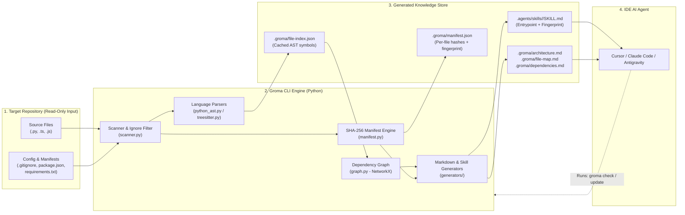
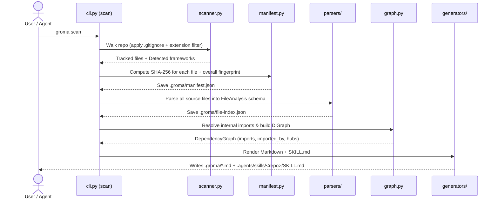
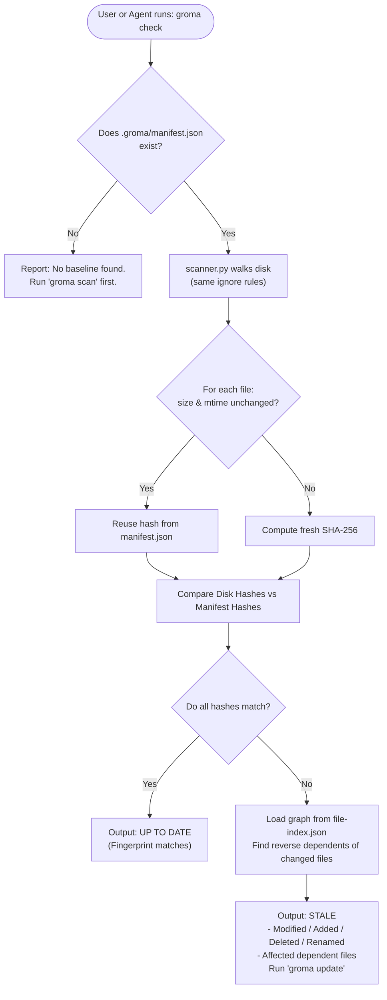
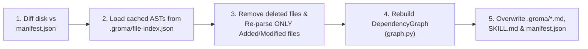
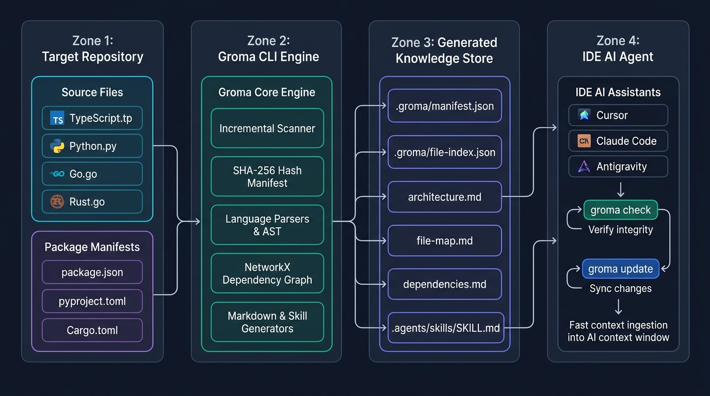
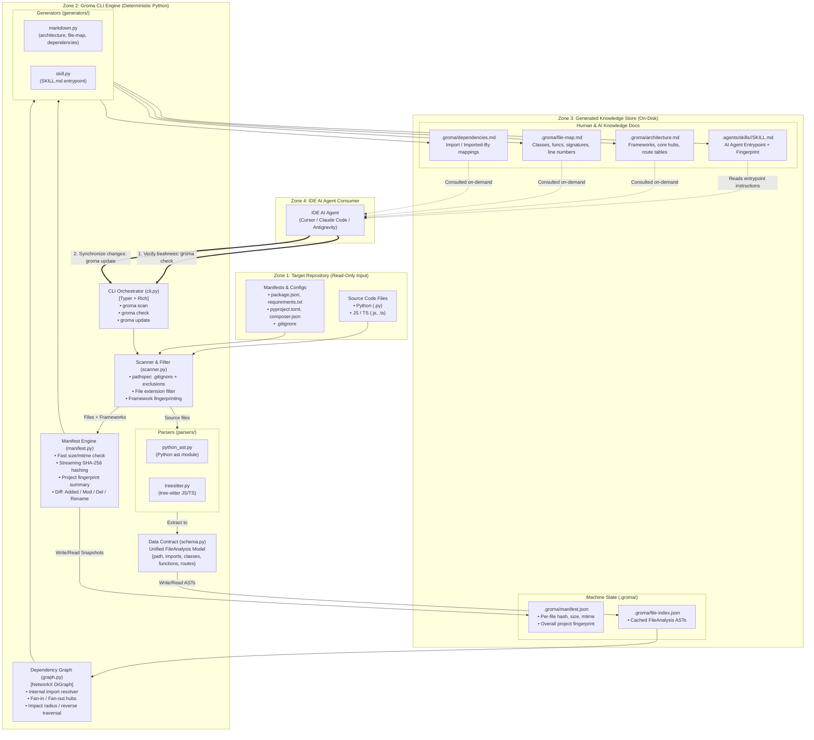
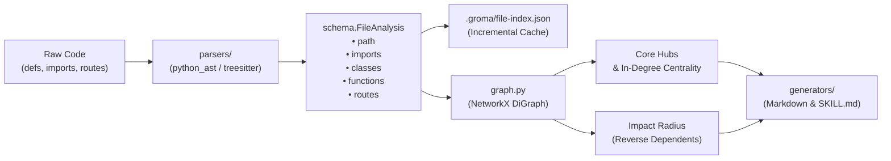

# Groma (CodeAtlas) — System Architecture Guide

This document walks through the complete architecture of **Groma**, a deterministic static analysis CLI that generates and maintains structured codebase knowledge (`SKILL.md` + `.groma/` docs) for IDE AI agents without requiring an LLM API key.

---

## 1. High-Level Mental Model (The 4-Box Diagram)

If you are drawing the top-level system on a whiteboard, there are **4 main zones**:

1. **Input (Target Codebase)**: Your project's raw source files (`.py`, `.ts`, `.js`), `.gitignore`, and package manifests (`package.json`, `requirements.txt`, `pyproject.toml`).
2. **Groma CLI Engine (Deterministic Python)**: Walks the files, hashes contents, parses ASTs into a unified schema, and builds an internal dependency graph.
3. **Generated Knowledge Store (On Disk)**:
   - **Machine State (`.groma/`)**: `manifest.json` (SHA-256 hashes) and `file-index.json` (cached AST symbols).
   - **Human & AI Docs (`.groma/*.md` + `SKILL.md`)**: `architecture.md`, `file-map.md`, `dependencies.md`, and the `.agents/skills/<repo>/SKILL.md` entrypoint.
4. **Consumer (IDE AI Agent)**: Cursor, Claude Code, or Antigravity,Cursor reads `SKILL.md`, answers questions or writes code, and runs `groma check` / `groma update` to keep the skill synchronized.



---

## 2. Internal Component Breakdown (6 Modules)

When drawing the internal architecture of the Python package, these are the **6 modules** and how they connect:

### Module 1: `cli.py` (The Orchestrator)
- **Technology**: `Typer` + `Rich`
- **Role**: Exposes three commands to the user and AI agent:
  - `groma scan`: Full baseline scan, hash snapshot, AST parse, graph build, and Markdown/Skill generation.
  - `groma check`: Read-only comparison of current disk hashes vs `manifest.json`. Reports `Added`, `Modified`, `Deleted`, `Renamed`, and `Affected Dependents`.
  - `groma update`: Incremental rebuild. Re-parses *only* changed files, updates the graph and Markdown files, and writes a fresh `manifest.json`.

### Module 2: `scanner.py` (The Gatekeeper)
- **Technology**: `pathlib`, `os.scandir`, `pathspec`
- **Inputs**: Repository root path.
- **Responsibilities**:
  1. Reads `.gitignore` and combines it with hard-coded ignore rules (`.git`, `node_modules`, `.venv`, `dist`, `.env`, `.groma`, `.agents`).
  2. Filters to supported source code extensions (`.py`, `.js`, `.ts`, etc.) and project manifests (`package.json`, `requirements.txt`, etc.) so editing an image or log file never triggers a false "stale" alert.
  3. **Framework Fingerprinting**: Inspects `package.json`, `requirements.txt`, `pyproject.toml`, and `composer.json` to detect frameworks (`FastAPI`, `Django`, `Next.js`, `React`, `Laravel`, etc.).
- **Output**: List of `(file_path, language)` tuples + list of detected frameworks.

### Module 3: `manifest.py` (The Snapshot & Diff Engine)
- **Technology**: `hashlib` (SHA-256), `json`
- **Responsibilities**:
  1. **Fast Check**: Compares file `size` and `mtime` (last modified timestamp) against the previous manifest before reading bytes. If unchanged, reuses the cached hash.
  2. **Content Hashing**: Streams changed/new files in 64 KB chunks through `hashlib.sha256()`.
  3. **Overall Project Fingerprint**: Combines all sorted `path:hash` pairs into one summary hash stored in both `manifest.json` and `SKILL.md`.
  4. **Diff Calculation**: Compares `old_manifest` vs `current_disk` to classify files into:
     - `Modified`: Same path, different hash.
     - `Added`: Path on disk, not in manifest.
     - `Deleted`: Path in manifest, not on disk.
     - `Renamed`: Deleted path + Added path with the exact same SHA-256 hash.

### Module 4: `schema.py` (The Unified Data Contract)
- **Technology**: `Pydantic` (or `dataclasses`)
- **Role**: Defines the strict JSON shape that **every** language parser must return. Because Python and JS/TS output the exact same `FileAnalysis` model, the graph builder and Markdown generators never care what language a file was written in.
- **Core Models**:
  - `FileHashEntry`: `{hash, size, mtime, language}`
  - `Manifest`: `{project_name, generated_at, fingerprint, frameworks, files}`
  - `FileAnalysis`: `{path, language, size, lines_of_code, module_docstring, imports, classes, functions, routes}`
  - `ClassInfo`: `{name, bases, decorators, docstring, start_line, end_line, methods}`
  - `FunctionInfo`: `{name, params, return_type, decorators, docstring, start_line, end_line, is_async, calls}`
  - `RouteInfo`: `{method, path, handler, line}`

### Module 5: `parsers/` (The Fact Extractors)
- **`python_ast.py`**: Uses Python's built-in `ast` module. Extracts classes, functions, type annotations, docstrings, imports, and HTTP route decorators (`@app.get("/users")`, `@router.post("/login")`).
- **`treesitter.py` (Phase 2)**: Uses `tree-sitter` to extract the exact same `FileAnalysis` schema from JavaScript/TypeScript files.

### Module 6: `graph.py` & `generators/` (The Synthesizer)
- **`graph.py` (NetworkX)**:
  - Resolves import statements (`from app.auth import verify`) to actual files in the repo (`backend/app/auth.py`).
  - Builds a directed graph (`A -> B` means file `A` imports file `B`).
  - Computes **Fan-In (In-Degree)**: Which files are imported the most across the repo ("Core Modules").
  - Computes **Impact Radius**: When `auth.py` is modified, walks reverse edges to find every file that directly or transitively depends on `auth.py`.
- **`generators/markdown.py` & `generators/skill.py`**:
  - Renders `.groma/architecture.md`, `.groma/file-map.md`, `.groma/dependencies.md`, and `.agents/skills/<project>/SKILL.md`.

---

## 3. Workflow Diagrams for the 3 Commands

### Flow A: `groma scan` (Initial Baseline & Full Build)



---

### Flow B: `groma check` (Read-Only Staleness & Impact Detection)

`check` **never modifies any files**. It compares disk state to `.groma/manifest.json`.



---

### Flow C: `groma update` (Fast Incremental Rebuild)

Instead of re-parsing the entire repository, `update` uses the diff from `manifest.py` to only re-parse files that actually changed on disk:



---

## 4. Directory & File Layout on Disk

When drawing the file layout, split it into **Your Tool's Code** vs **What Your Tool Generates Inside a Target Repo**:

### A. Your Tool's Source Layout (`groma/`)
```text
Groma/
├── pyproject.toml
└── groma/
    ├── __init__.py
    ├── cli.py              # scan, check, update commands
    ├── schema.py           # Pydantic / dataclass models
    ├── scanner.py          # .gitignore walker + framework detection
    ├── manifest.py         # SHA-256 hashing + diffing
    ├── graph.py            # Import resolution + NetworkX graph
    ├── parsers/
    │   ├── __init__.py
    │   ├── python_ast.py   # Built-in ast extractor (Step 2)
    │   └── treesitter.py   # JS/TS extractor (Step 3)
    └── generators/
        ├── __init__.py
        ├── markdown.py     # architecture.md, file-map.md, dependencies.md
        └── skill.py        # SKILL.md with YAML frontmatter
```

### B. Generated Output Inside Any Target Project
```text
target-project/
├── .groma/                         # Machine state + detailed reference tables
│   ├── manifest.json               # Per-file {hash, size, mtime} + overall fingerprint
│   ├── file-index.json             # Cached FileAnalysis AST objects for incremental updates
│   ├── architecture.md             # Frameworks, core high-centrality files, HTTP routes
│   ├── file-map.md                 # Classes, functions, signatures, and exact line numbers
│   └── dependencies.md             # Per-file "Imports" and "Imported By" lists
│
└── .agents/
    └── skills/
        └── target-project-knowledge/
            └── SKILL.md            # Lightweight AI entrypoint pointing to .groma/*.md
```

---

## 5. How the AI Agent Loop Works (Keeping the Skill Fresh)

Why doesn't the LLM corrupt the skill over time?
Because **the LLM never hand-edits `.groma/*.md`**. Instead, `SKILL.md` embeds two rules in its instructions:

1. **Before answering architecture questions**: Run `groma check` to verify the skill matches the current working tree.
2. **After completing code changes**: Run `groma update` so Groma deterministically re-parses the edited files, recalculates the dependency graph, updates `.groma/*.md`, and writes the new `manifest.json` snapshot.

---

## 6. Comprehensive Architecture & Data Flow Diagrams



### Diagram 1: Full System Architecture & Data Flow
The complete map of external inputs, internal modules, the unified schema contract, generated artifacts, and the AI agent loop:



---

### Diagram 2: Command Execution & State Transition Loop

```mermaid
flowchart TD
    CMD{"Invoked Command"}

    %% SCAN
    subgraph ScanPath["groma scan (Cold Baseline)"]
        S1["Walk repo & filter .gitignore"] --> S2["Compute all SHA-256 hashes"]
        S2 --> S3["Parse all source files to FileAnalysis"]
        S3 --> S4["Build NetworkX import graph"]
        S4 --> S5["Write .groma/manifest.json & file-index.json"]
        S5 --> S6["Generate .groma/*.md & SKILL.md"]
    end

    %% CHECK
    subgraph CheckPath["groma check (Read-Only Staleness & Impact)"]
        C1["Fast check: size & mtime unchanged?"]
        C1 -- Yes --> C2["Reuse cached hash"]
        C1 -- No --> C3["Compute fresh SHA-256"]
        C2 & C3 --> C4["Diff against manifest.json"]
        C4 --> C5{"Hashes Match?"}
        C5 -- Yes --> C6["Report: UP TO DATE"]
        C5 -- No --> C7["Traverse graph: Find reverse dependents"]
        C7 --> C8["Report: STALE + Changed files + Impact radius"]
    end

    %% UPDATE
    subgraph UpdatePath["groma update (Incremental Rebuild)"]
        U1["Diff working tree vs manifest.json"]
        U1 --> U2["Load cached file-index.json"]
        U2 --> U3["Remove deleted files & re-parse ONLY added/modified files"]
        U3 --> U4["Recompute NetworkX dependency graph"]
        U4 --> U5["Overwrite manifest.json, .groma/*.md, and SKILL.md"]
    end

    CMD -->|"Initial Setup"| ScanPath
    CMD -->|"Pre-task verification"| CheckPath
    CMD -->|"Post-edit sync"| UpdatePath
```



---

### Diagram 3: Schema Transformation & Impact Pipeline




